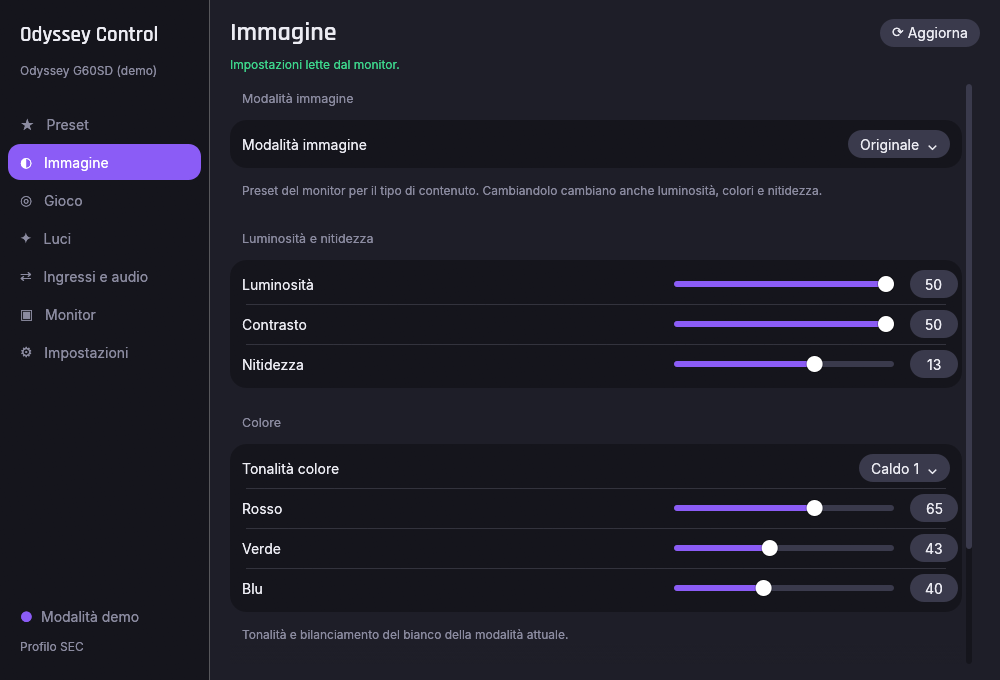
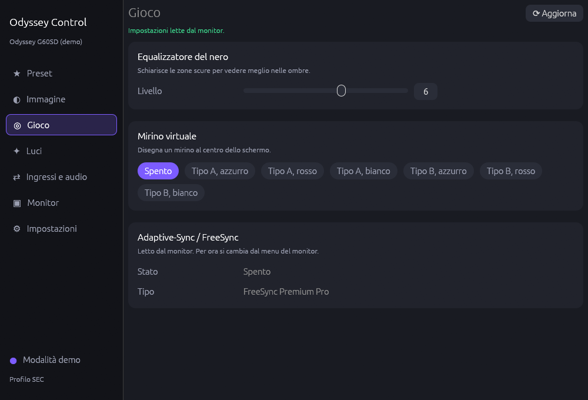
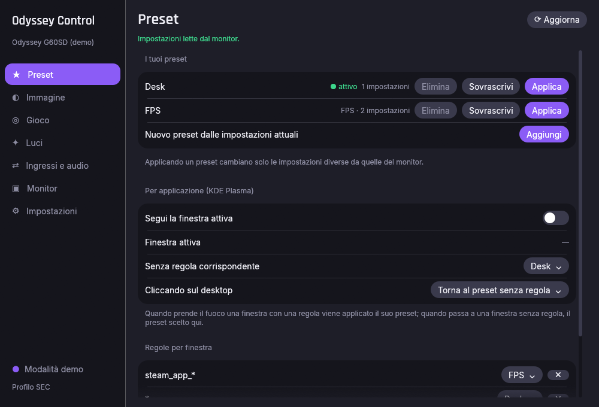
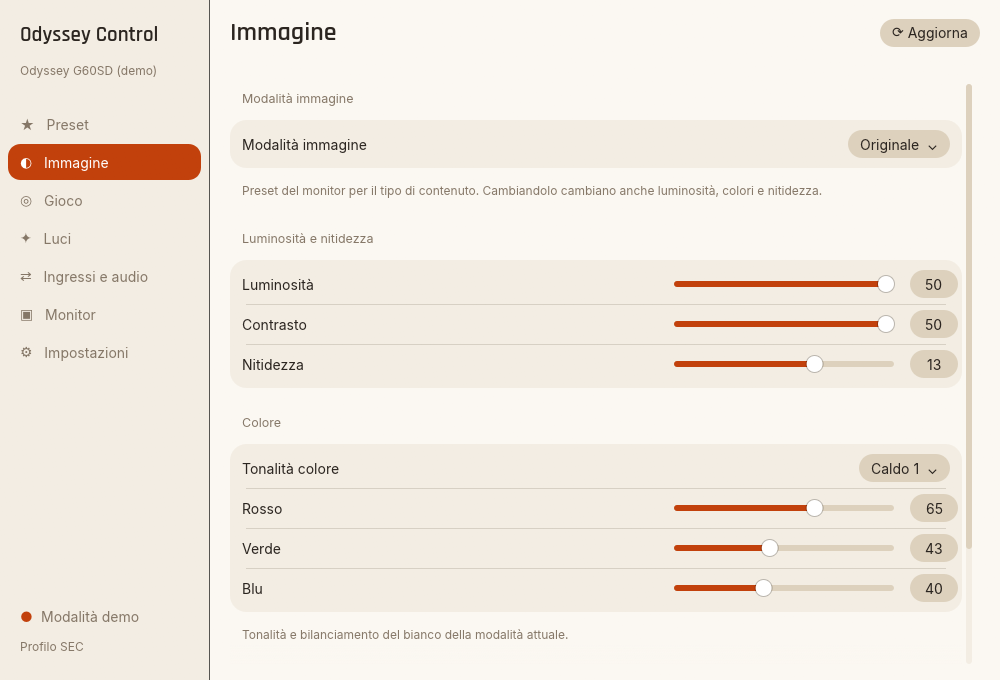
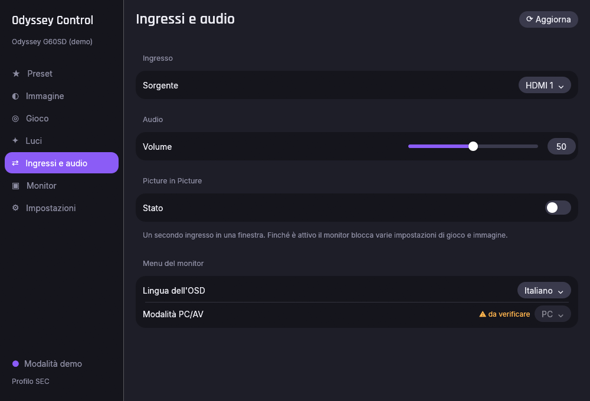

# odyssey-ctl

Controlla i monitor Samsung Odyssey da Linux (e Windows) via DDC/CI: impostazioni di immagine,
gioco e luci, preset, uno strumento da riga di comando e un'app desktop con icona nel tray.

Samsung non offre software per monitor su Linux. `odyssey-ctl` parla direttamente con il monitor
attraverso il cavo video, con gli stessi comandi di Samsung Display Manager, ricavati facendone il
reverse engineering. Nessun componente del software Samsung è incluso.

*Read this document in English: [README.md](README.md).*



## Funzioni

- **Immagine**: modalità immagine, luminosità, contrasto, nitidezza, tonalità colore, bilanciamento
  del bianco, Eye Saver.
- **Gioco**: Equalizzatore del nero, Mirino virtuale con posizionamento (frecce, coordinate, centratura), Adaptive-Sync/FreeSync.
- **Luci**: Infinity Core Lighting acceso/spento, effetto e colore.
- **Ingressi e audio**: sorgente, volume, Picture-in-Picture (accensione, dimensione, angolo, ingressi, audio), lingua dell'OSD, modalità PC/AV.
- **Preset**: salva lo stato attuale con un nome e torna indietro con un clic, anche dall'icona
  nel tray a finestra chiusa. Vengono scritte solo le impostazioni diverse.
- Ogni scrittura viene riletta dal monitor; le voci che il monitor dichiara non disponibili (per
  esempio con Eye Saver attivo) sono mostrate come tali e mai scritte.
- Inglese e italiano; l'app segue la lingua e il tema di sistema (chiaro o scuro, o scegli tu nelle Impostazioni).
- Nessuna lettura in background: il monitor viene letto all'apertura e premendo Aggiorna, così il
  suo menu continua a funzionare.

| Gioco | Preset |
|---|---|
|  |  |

| Tema chiaro | Ingressi e audio |
|---|---|
|  |  |

## Compatibilità

| Monitor | Firmware | Stato |
|---|---|---|
| Odyssey OLED G6 G60SD (LS27DG602S) | 1006.0 | Provato: tutto quanto sopra verificato a schermo |
| Odyssey OLED G6 G60SD | 1003.0 | Provato: le letture funzionano, le scritture sono limitate alle voci standard (vedi sotto) |
| Altri modelli Odyssey (dal 2023) | – | Non provati; ci si aspetta che gli stessi comandi Samsung funzionino. Segnalalo con il template delle issue |

Il firmware conta. Con quello vecchio (1003.0, profilo `FALCON`) il monitor ignora in silenzio le
scritture sulle voci Samsung; dal 1006.0 (profilo `SEC`, o `LEMON24v1` dopo l'handshake `sdm on`)
funzionano. L'aggiornamento si installa da chiavetta USB dal menu del monitor (Supporto →
Aggiornamento software); vedi la pagina di supporto Samsung del tuo modello.

Le voci la cui scrittura non è stata verificata su un monitor restano bloccate nell'app finché non
attivi "Voci non verificate" nelle Impostazioni, e richiedono `--unverified` da riga di comando.

## Installazione

### Arch Linux (AUR)

```sh
yay -S odyssey-ctl        # compila dai sorgenti
yay -S odyssey-ctl-bin    # binari della release
```

Il pacchetto installa la regola udev e carica il modulo `i2c-dev` all'avvio; dopo la prima
installazione esci e rientra nella sessione (o esegui
`sudo udevadm trigger --subsystem-match=i2c-dev`).

### Altre distribuzioni Linux

Scarica `odyssey-ctl-<versione>-linux-x86_64.tar.gz` dalle
[release](https://github.com/deddroid/odyssey-ctl/releases), estrailo ed esegui:

```sh
./install.sh --udev
```

Installa binari, voce di menu e icone in `~/.local` e, con `sudo`, la regola udev e la
configurazione del modulo `i2c-dev` che danno al tuo utente l'accesso al monitor senza root.
`./install.sh --uninstall` rimuove tutto; impostazioni e preset restano in
`~/.config/odyssey-ctl`.

### Windows

Scarica lo `.zip` dalle release ed esegui `odyssey-ctl-gui.exe` (o `odyssey-ctl.exe` da un
terminale). La versione Windows è prodotta dalla CI ma **non è ancora stata provata su una
macchina reale**: le segnalazioni sono benvenute. SmartScreen può avvisare al primo avvio perché i
binari non sono firmati.

### Dai sorgenti

```sh
cargo build --release                        # CLI + GUI
cargo build --release --no-default-features  # solo CLI
./install.sh --udev
```

Richiede Rust 1.88 o successivo.

## Uso

### App desktop

Avvia **Odyssey Control** dal menu delle applicazioni o esegui `odyssey-ctl-gui`. Chiudendo la
finestra l'app resta nel tray (configurabile in Impostazioni → Tray e avvio, insieme all'avvio
automatico all'accesso); il menu del tray elenca i tuoi preset.

### Riga di comando

```sh
odyssey-ctl list                      # monitor trovati e relativo bus I2C
odyssey-ctl info                      # capability string e profilo firmware
odyssey-ctl get                       # tutte le voci conosciute
odyssey-ctl get brightness picture-mode
odyssey-ctl set brightness 40
odyssey-ctl set brightness +5         # passo relativo, entro i limiti del monitor
odyssey-ctl set picture-mode fps --unverified
odyssey-ctl set lighting-effect static
odyssey-ctl preset list               # presets.toml, condiviso con l'app desktop
odyssey-ctl preset save Scrivania     # le impostazioni attuali del monitor, con un nome
odyssey-ctl preset apply Notte        # scrive solo ciò che differisce; esce con 1 se una scrittura fallisce
odyssey-ctl features                  # nomi, codici VCP e stato di verifica
odyssey-ctl sdm on                    # profilo esteso Samsung (EB=A1); 'off' per tornare
odyssey-ctl raw get 2f                # qualsiasi codice VCP
odyssey-ctl raw set 2f 6
```

Con più monitor collegati, `--bus N` sceglie quale usare.

### Automazioni

Tutto quello che segue chiama solo lo strumento a riga di comando, quindi funziona ovunque si
possa eseguire un comando. Il monitor non viene mai interrogato in continuazione: ogni gancio
scrive una volta sola.

- **Scorciatoie da tastiera (KDE):** Impostazioni di sistema → Scorciatoie → Aggiungi nuova →
  Comando o script, con `odyssey-ctl set brightness +5` (e `-5`), oppure
  `odyssey-ctl preset apply Notte`.
- **Giochi:** opzioni di avvio di Steam
  `odyssey-ctl preset apply FPS; %command%; odyssey-ctl preset apply Scrivania`, oppure con
  [GameMode](https://github.com/FeralInteractive/gamemode) in `~/.config/gamemode.ini`:
  `start=odyssey-ctl preset apply FPS` e `end=odyssey-ctl preset apply Scrivania` sotto `[custom]`.
- **Orari fissi:** le unità utente in [`packaging/systemd/`](packaging/systemd/):
  `odyssey-ctl-preset@.service` applica il preset con il nome dell'istanza e
  `odyssey-ctl-night.timer` è un esempio di orario (copia entrambi in `~/.config/systemd/user/`,
  poi `systemctl --user enable --now odyssey-ctl-night.timer`).
- **Al ripristino dalla sospensione:**
  [`packaging/systemd/odyssey-ctl-resume`](packaging/systemd/odyssey-ctl-resume) è un gancio di
  systemd-sleep che applica un preset qualche secondo dopo il ripristino, come l'utente indicato in
  `/etc/odyssey-ctl/resume.conf`; i commenti in testa spiegano come installarlo (root).

### Variabili d'ambiente

| Variabile | Effetto |
|---|---|
| `ODYSSEY_CTL_DEBUG=1` | Stampa ogni pacchetto DDC/CI inviato e ricevuto |
| `ODYSSEY_CTL_DEMO=1` | Usa una copia incorporata di un G60SD al posto del monitor reale |
| `ODYSSEY_CTL_SCREENSHOTS=<cartella>` | GUI: salva uno screenshot di ogni pagina in ogni lingua e tema, poi esce |
| `ODYSSEY_CTL_CONFIG_DIR=<cartella>` | Dove stanno `settings.toml` e `presets.toml` |
| `ODYSSEY_CTL_DDC_REPLY_MS`, `ODYSSEY_CTL_DDC_GAP_MS` | Tempi DDC/CI (default 30 e 20 ms); alzali se un monitor risponde con errori |

## Limiti noti

- I nomi dei colori usati da Samsung per le luci non coincidevano con quello che mostravano i LED,
  quindi il colore è un numero (0–47).
- Audio PIP e modalità PC/AV sono implementati ma la loro scrittura non è ancora verificata.
- I layout PBP vengono da SDM ma il G60SD non ha il PBP: non provati.
- Il ripristino del bilanciamento del bianco (`reset-white-balance`) non ha effetto sul G60SD: il registro accetta la scrittura e la ignora.
- Più monitor: la GUI ne controlla uno alla volta (pagina Monitor); il passaggio non è provato con un secondo monitor.
- Windows: non provato, vedi sopra.
- Leggere il monitor in continuazione fa chiudere il suo menu a schermo, perciò l'app non fa mai polling.

## Come funziona

Il protocollo, i comandi specifici Samsung e ciò che è stato verificato sull'hardware sono
documentati in [docs/PROTOCOL.md](docs/PROTOCOL.md) (in inglese). La libreria (`src/lib.rs`)
costruisce e interpreta ogni pacchetto senza hardware ed è coperta da test; CLI e GUI sono strati
sottili sopra di essa.

## Crediti

- Prove sull'hardware, idee e pazienza: [deddroid](https://github.com/deddroid).
- Codice, reverse engineering e documentazione scritti con [Claude](https://claude.com) (Anthropic).
- [ilyamen/samsung-odyssey-ddc-unlock](https://github.com/ilyamen/samsung-odyssey-ddc-unlock)
  per la prima analisi dei profili firmware SEC/LEMON.
- [clever-trevor/samsung-monitor-control](https://github.com/clever-trevor/samsung-monitor-control),
  [gurgelx/Samsung-Odyssey-DDC-tools](https://github.com/gurgelx/Samsung-Odyssey-DDC-tools) e
  [olebru/streamdeck-ddc-monitor-control](https://github.com/olebru/streamdeck-ddc-monitor-control)
  per i codici PBP e degli ingressi di altri modelli Odyssey.
- [ddcutil](https://www.ddcutil.com/) per le prime prove e la regola udev.
- L'interfaccia è realizzata con [egui](https://github.com/emilk/egui) e include i font [Inter](https://rsms.me/inter/) e
  [Rajdhani](https://fonts.google.com/specimen/Rajdhani) (SIL Open Font License, vedi `assets/fonts/`).

Samsung e Odyssey sono marchi di Samsung Electronics. Questo progetto non è affiliato a Samsung.

## Licenza

[MIT](LICENSE).
