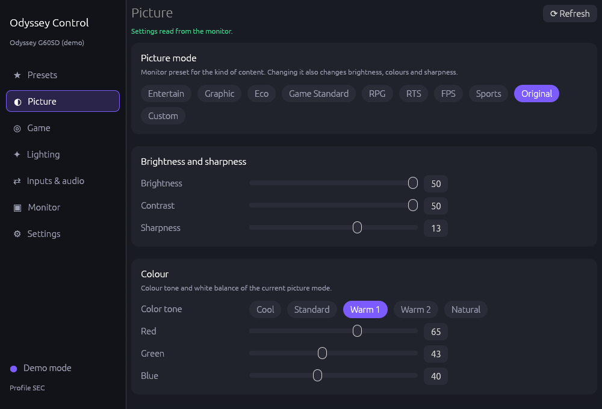
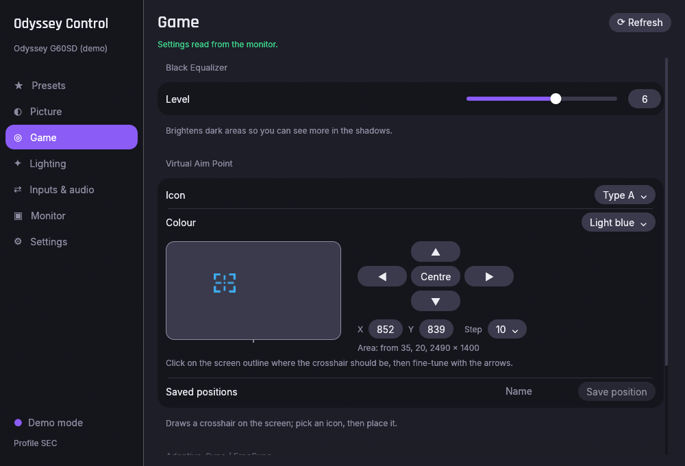
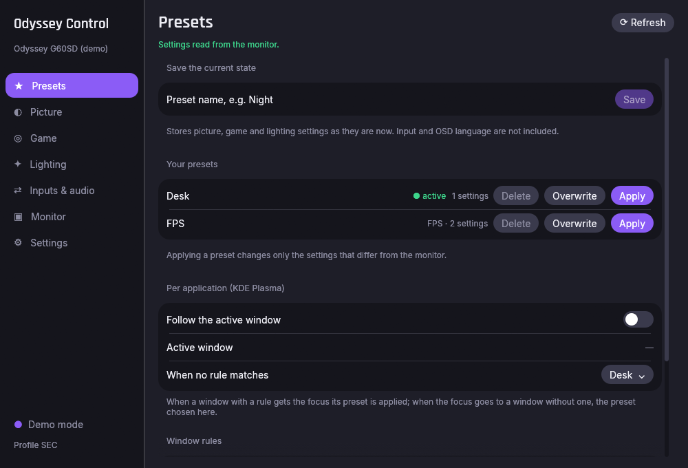
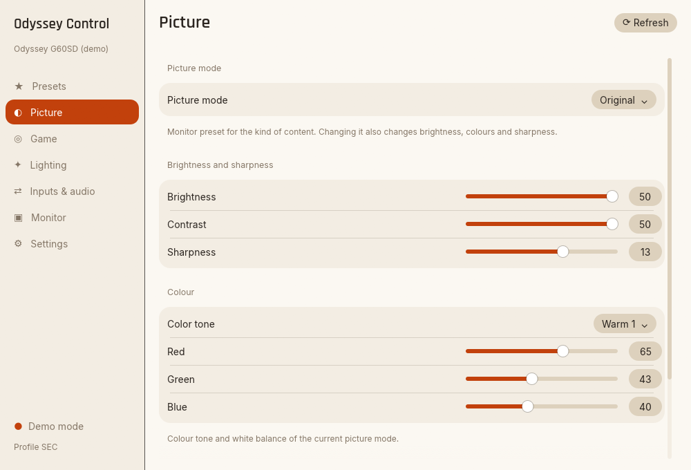
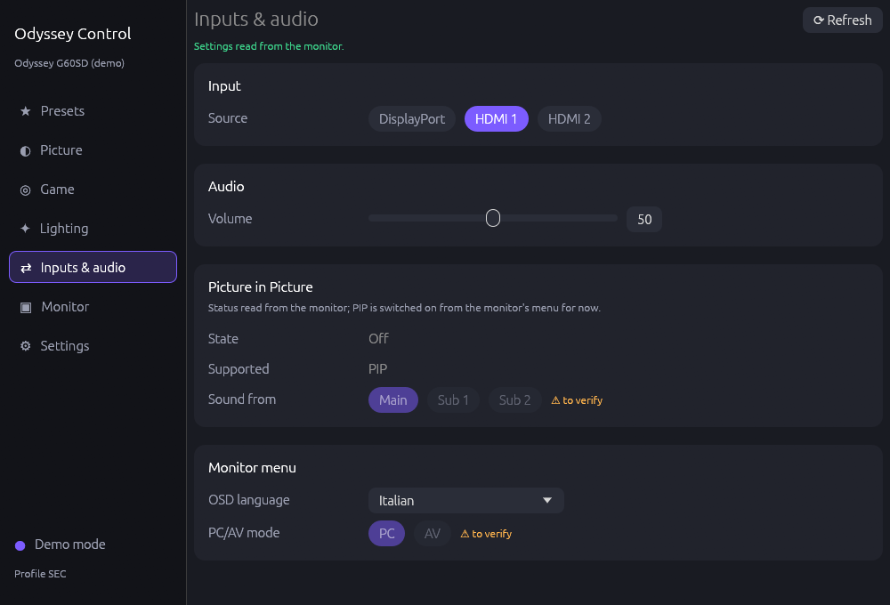

# odyssey-ctl

Control Samsung Odyssey monitors from Linux (and Windows) over DDC/CI: picture, game and
lighting settings, presets, a command line tool and a desktop app with a tray icon.

Samsung ships no monitor software for Linux. `odyssey-ctl` talks to the monitor directly over the
video cable, using the same commands Samsung Display Manager uses, found by reverse engineering
it. Nothing from Samsung's software is included.

*Leggi questo documento in italiano: [README.it.md](README.it.md).*



## Features

- **Picture**: picture mode, brightness, contrast, sharpness, colour tone, white balance, Eye Saver.
- **Game**: Black Equalizer, Virtual Aim Point with placement (arrows, coordinates, centre), Adaptive-Sync/FreeSync.
- **Lighting**: Infinity Core Lighting on/off, effect and colour.
- **Inputs & audio**: input source, volume, Picture-in-Picture (on/off, size, corner, inputs, sound), OSD language, PC/AV mode.
- **Presets**: save the current state by name and get back to it with one click, also from the
  tray icon with the window closed. Only the settings that differ are written.
- **Per application** (KDE Plasma): a preset per window class, applied when that window gets the
  focus, and one to return to.
- Every write is read back from the monitor; settings the monitor reports as unavailable (for
  example while Eye Saver is on) are shown as such and never written.
- English and Italian; the app follows the system language and theme (light or dark, or pick one in Settings).
- No background polling: the monitor is read when you open the app or press Refresh, so its own
  menu keeps working.

| Game | Presets |
|---|---|
|  |  |

| Light theme | Inputs & audio |
|---|---|
|  |  |

## Compatibility

| Monitor | Firmware | Status |
|---|---|---|
| Odyssey OLED G6 G60SD (LS27DG602S) | 1006.0 | Tested: everything above verified on screen |
| Odyssey OLED G6 G60SD | 1003.0 | Tested: reads work, writes limited to the standard settings (see below) |
| Other Odyssey models (2023 or later) | – | Untested; the same Samsung commands are expected to work. Please report with the issue template |

Firmware matters. On older firmware (1003.0, capability profile `FALCON`) the monitor silently
ignores writes to Samsung-specific settings; from 1006.0 (profile `SEC`, or `LEMON24v1` after the
`sdm on` handshake) they work. Firmware updates are installed from a USB stick through the
monitor's menu (Support → Software Update); see Samsung's support page for your model.

Settings whose write has not been verified on a monitor are locked in the app until you enable
"Unverified settings" in Settings, and need `--unverified` on the command line.

## Installation

### Arch Linux (AUR)

```sh
yay -S odyssey-ctl        # builds from source
yay -S odyssey-ctl-bin    # prebuilt release binaries
```

The package installs the udev rule and loads the `i2c-dev` module at boot; log out and in again
(or run `sudo udevadm trigger --subsystem-match=i2c-dev`) after the first install.

### Other Linux distributions

Download `odyssey-ctl-<version>-linux-x86_64.tar.gz` from the
[releases](https://github.com/deddroid/odyssey-ctl/releases), extract it and run:

```sh
./install.sh --udev
```

This installs the binaries, desktop entry and icons in `~/.local`, plus (with `sudo`) the udev
rule and the `i2c-dev` module configuration that give your user access to the monitor without
root. `./install.sh --uninstall` removes everything; settings and presets stay in
`~/.config/odyssey-ctl`.

### Windows

Download the `.zip` from the releases and run `odyssey-ctl-gui.exe` (or `odyssey-ctl.exe` from a
terminal). The Windows build is produced by CI but has **not been tested on a real machine yet**:
reports are welcome. Windows SmartScreen may warn at first start because the binaries are not
signed.

### From source

```sh
cargo build --release                        # CLI + GUI
cargo build --release --no-default-features  # CLI only
./install.sh --udev
```

Requires Rust 1.88 or newer.

## Usage

### Desktop app

Start **Odyssey Control** from your application menu or run `odyssey-ctl-gui`. Closing the window
keeps the app in the tray (configurable in Settings → Tray and startup, together with autostart
at login); the tray menu lists your presets.

### Command line

```sh
odyssey-ctl list                      # monitors found and their I2C bus
odyssey-ctl info                      # capability string and firmware profile
odyssey-ctl get                       # every known setting
odyssey-ctl get brightness picture-mode
odyssey-ctl set brightness 40
odyssey-ctl set brightness +5         # relative step, kept within the monitor's range
odyssey-ctl set picture-mode fps --unverified
odyssey-ctl set lighting-effect static
odyssey-ctl preset list               # presets.toml, shared with the desktop app
odyssey-ctl preset save Desk          # the monitor's current settings, by name
odyssey-ctl preset apply Night        # writes only what differs; exit code 1 if a write fails
odyssey-ctl features                  # names, VCP codes and verification status
odyssey-ctl sdm on                    # Samsung extended profile (EB=A1); 'off' to return
odyssey-ctl raw get 2f                # any VCP code
odyssey-ctl raw set 2f 6
```

Use `--bus N` to pick a monitor when more than one is connected.

### Automation

Everything below only calls the command line tool, so it works wherever a command can be run.
The monitor is never polled: each hook writes once.

- **Keyboard shortcuts (KDE):** System Settings → Shortcuts → Add new → Command or script, with
  `odyssey-ctl set brightness +5` (and `-5`), or `odyssey-ctl preset apply Night`.
- **Games:** Steam launch options
  `odyssey-ctl preset apply FPS; %command%; odyssey-ctl preset apply Desk`, or with
  [GameMode](https://github.com/FeralInteractive/gamemode) in `~/.config/gamemode.ini`:
  `start=odyssey-ctl preset apply FPS` and `end=odyssey-ctl preset apply Desk` under `[custom]`.
- **Fixed times:** the user units in [`packaging/systemd/`](packaging/systemd/):
  `odyssey-ctl-preset@.service` applies the preset named after the instance and
  `odyssey-ctl-night.timer` is an example schedule (copy both to `~/.config/systemd/user/`, then
  `systemctl --user enable --now odyssey-ctl-night.timer`).
- **Per application (KDE Plasma 6):** in the desktop app, Presets → Per application, switch on
  *Follow the active window*. It installs a small KWin script that reports the focused window to
  the app over D-Bus (one call per focus change, no polling). Add a rule per window class (the
  *Active window* row shows it; `*` and `?` are wildcards) and the preset to apply, and pick the
  preset to return to when a window without a rule gets the focus. The rules live in
  `presets.toml` (`[[app]]` and `app_default`).
- **After suspend:** [`packaging/systemd/odyssey-ctl-resume`](packaging/systemd/odyssey-ctl-resume)
  is a systemd-sleep hook that applies a preset a few seconds after resume, as the user named in
  `/etc/odyssey-ctl/resume.conf`; the comments at the top show how to install it (root).

### Environment variables

| Variable | Effect |
|---|---|
| `ODYSSEY_CTL_DEBUG=1` | Print every DDC/CI packet sent and received |
| `ODYSSEY_CTL_DEMO=1` | Use a built-in copy of a G60SD instead of a real monitor |
| `ODYSSEY_CTL_SCREENSHOTS=<dir>` | GUI: save a screenshot of every page in every language and theme, then exit |
| `ODYSSEY_CTL_CONFIG_DIR=<dir>` | Where `settings.toml` and `presets.toml` live |
| `ODYSSEY_CTL_DDC_REPLY_MS`, `ODYSSEY_CTL_DDC_GAP_MS` | DDC/CI timing (defaults 30 and 20 ms); raise them for a monitor that answers with errors |

## Known limits

- The colour names Samsung uses for the lighting did not match what the LEDs showed, so the
  colour is a number (0–47).
- PIP sound and PC/AV mode are implemented but their writes are still unverified.
- PBP layouts are implemented from SDM but the G60SD has no PBP; untested.
- The white balance reset (`reset-white-balance`) has no effect on the G60SD: the register is accepted but ignored.
- Several monitors: the GUI controls one at a time (Monitor page); switching is untested with a second monitor.
- Windows: untested, see above.
- Reading the monitor continuously makes its on-screen menu close, so the app never polls.

## How it works

The protocol, the Samsung-specific commands and what was verified on hardware are documented in
[docs/PROTOCOL.md](docs/PROTOCOL.md). The library (`src/lib.rs`) builds and parses every packet
without hardware and is covered by unit tests; the CLI and the GUI are thin layers over it.

## Credits

- Hardware testing, ideas and patience: [deddroid](https://github.com/deddroid).
- Code, reverse engineering and documentation written with [Claude](https://claude.com) (Anthropic).
- [ilyamen/samsung-odyssey-ddc-unlock](https://github.com/ilyamen/samsung-odyssey-ddc-unlock)
  for the first analysis of the SEC/LEMON firmware profiles.
- [clever-trevor/samsung-monitor-control](https://github.com/clever-trevor/samsung-monitor-control),
  [gurgelx/Samsung-Odyssey-DDC-tools](https://github.com/gurgelx/Samsung-Odyssey-DDC-tools) and
  [olebru/streamdeck-ddc-monitor-control](https://github.com/olebru/streamdeck-ddc-monitor-control)
  for the PBP and input codes of other Odyssey models.
- [ddcutil](https://www.ddcutil.com/) for the first probes and the udev rule.
- The GUI is built with [egui](https://github.com/emilk/egui); it bundles the [Inter](https://rsms.me/inter/) and
  [Rajdhani](https://fonts.google.com/specimen/Rajdhani) fonts (SIL Open Font License, see `assets/fonts/`).

Samsung and Odyssey are trademarks of Samsung Electronics. This project is not affiliated with Samsung.

## License

[MIT](LICENSE).
